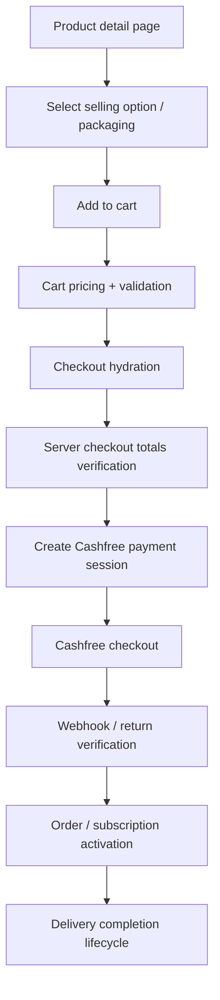

# Website Customer Flows for Mobile Parity

This document is a repo-based analysis of the current website’s customer purchase flow. It is intended as a source-of-truth reference for a future mobile implementation and is limited to behavior directly verified in the current codebase.

## Scope and source of truth

This analysis uses the current repository implementation as authoritative. It intentionally excludes historical docs, assumptions, or prior design notes. Where behavior depends on live Firestore data, provider callbacks, or external payment events, it is called out as an unverified runtime branch rather than treated as guaranteed.

Primary implementation areas reviewed:
- `lib/subscriptionPlanPricing.ts`
- `lib/priceDisplay.ts`
- `lib/cart.ts`
- `lib/checkoutPricing.ts`
- `lib/customerMixedCheckout.ts`
- `lib/customerAlerts.ts`
- `lib/customerSubscriptions.ts`
- `lib/server/checkoutClaims.ts`
- `lib/server/checkoutTotals.ts`
- `lib/server/cashfreeCreateOrder.ts`
- `lib/server/cashfreePayment.ts`
- `lib/server/deliveryCompletion.ts`
- `components/ProductDetailPage.tsx`
- `components/CartPage.tsx`
- `components/CheckoutHydrator.tsx`
- `app/api/cashfree/webhook/route.ts`
- `functions/src/index.ts`

## High-level customer flow

## 1. Product pricing and option selection

### 1.1 One-time product pricing

The product detail page resolves the selected selling option from the active product options list. The active option set is filtered to entries with `active !== false` and `weightGrams > 0`, then sorted by weight.

Verified behavior:
- One-time products are priced from the selected selling option.
- The `mrp` and `price` are taken from the selected option.
- Product packaging is represented by `weightGrams`, mapped to a label such as `250g`, `500g`, etc.

Relevant implementation:
- `components/ProductDetailPage.tsx`
- `lib/subscriptionPlanPricing.ts`
- `lib/priceDisplay.ts`

### 1.2 Strikethrough/original price display

The price display logic is centralized in `lib/priceDisplay.ts`.

Rules actually implemented:
- `resolvePriceDisplay(sellingPrice, originalPrice)` shows an original price only when:
  - the original value is a number or numeric string,
  - it is finite,
  - it is not empty,
  - and `original > sellingPrice`.
- `savings` is computed as `original - sellingPrice`.
- If the original value is missing, equal, or lower than the selling price, the original/savings display is hidden.

This is important for mobile parity: the UI should not show a “was/now” discount unless the repo’s actual rule is satisfied.

### 1.3 Subscription plan pricing

Subscription pricing is resolved by `lib/subscriptionPlanPricing.ts`.

Rules in code:
- `getSubscriptionSellingOptions(plan)` filters valid entries with positive `weightGrams` and non-negative `planPrice`.
- `resolveSubscriptionPlanPrices(plan, selection)` resolves a size match using:
  1. packaging match when available,
  2. fallback to selling option ID if no packaging match is found,
  3. fallback to `plan.price` when no option is selected.
- `maximumPlanPrice` is used as the reference for display when it is greater than the selected plan price.

This matches the website rule that subscription “original price” and “savings” are derived from a maximum plan price reference, not from a generic product MRP.

## 2. Cart behavior

The cart is implemented in `lib/cart.ts` and is intentionally split into one-time and subscription entries.

### 2.1 Cart structure

Stored cart state has:
- `oneTimeItems[]`
- `subscriptionItems[]`

Each item stores product metadata, quantity, packaging, price, currency, and for subscriptions:
- `planId`
- `planName`
- `startDate`
- `frequency`
- `deliveriesPerTerm`

### 2.2 Subscription start-date rule

`validSubscriptionStartDate(startDate, earliestDate)` enforces a strong rule:
- the date must match `YYYY-MM-DD`
- the value must not be earlier than the effective earliest valid Saturday
- if the stored date is invalid or not a Saturday, it is replaced with the earliest valid date

The website’s rule is effectively: a subscription start must be a Saturday on or after next week’s Saturday.

### 2.3 Cart checkout-date handling

`checkoutSubscriptionDate(item, earliestDate)` ensures a subscription can only continue with a valid accepted delivery date. If the accepted date is earlier than the earliest valid date, the checkout flow falls back to a cart correction path instead of proceeding.

### 2.4 Cart update semantics

Cart operations preserve product identity and treat subscription and one-time selections distinctly. There are separate update functions for:
- one-time packaging and quantity changes
- subscription quantity changes
- subscription packaging changes
- replacing a one-time product selection with a new one
- removing a subscription item from the cart

This matters for mobile parity because the logic is not a single generic cart; the app uses separate handling for one-time and recurring flow.

## 3. Checkout lifecycle

### 3.1 Mixed checkout creation

The checkout creation flow is implemented in `lib/customerMixedCheckout.ts` and is validated against price calculations and availability checks before payment is created.

The checkout flow has these key responsibilities:
- merge product and subscription checkout entries
- validate product availability for requested dates and quantities
- create order records and subscription records in a customer-scoped structure
- apply pricing and delivery logic
- prevent concurrent duplicate checkout claims

### 3.2 Claim protection and single active checkout

`lib/server/checkoutClaims.ts` protects the checkout process from duplicate or superseded attempts.

Verified rules:
- only one active pending checkout should be attached per customer at a time
- a stale or previous checkout can be reconciled or cancelled
- payment creation does not proceed for a superseded cart
- the system prevents creating a paid/finalized order from a stale checkout attempt

This is a critical mobile parity rule: a customer should not be able to double-activate a payment from a stale cart or duplicate checkout attempt.

### 3.3 Server-side total verification

`lib/server/checkoutTotals.ts` is the authoritative price validator. The website does not trust browser-written totals.

Before a payment session is created, the server re-prices the order and validates:
- product line totals
- selected selling options and packaging
- subscription plan selection and pricing
- delivery charges
- entitlement totals / discounts
- final checkout total

If totals mismatch, the server rejects the checkout with a 409-style mismatch path. This is a mandatory parity rule for any mobile implementation: server re-pricing should be authoritative.

## 4. Payment flow

### 4.1 Cashfree payment-session creation

The Cashfree session creation path is handled in `lib/server/cashfreeCreateOrder.ts` and is wired through the server function entrypoints in `functions/src/index.ts`.

Verified behavior:
- A payment session is created only after checkout totals are verified.
- The server stores payment-session metadata on the corresponding order records.
- Duplicate concurrent payment creation is prevented via a payment locking pattern.
- Prior gateway orders are reused when still active; stale or unpayable orders are terminated/reconciled.

### 4.2 Payment verification and finalization

`lib/server/cashfreePayment.ts` is the authoritative payment finalization logic.

Verified rules:
- Payment success/failure is decided by the server and not by a browser callback.
- Browser-level return screens are treated as recovery paths, not the source of truth.
- Payment states have distinct semantics; `payment_pending` and `pending_payment` are not treated as interchangeable.
- Duplicate payment success events are recorded as reconciliation cases (for example, duplicate success or superseded payment received) rather than reactivating stale data.
- Order and subscription transition logic writes the final `paid`, `confirmed`, `active`, or `failed` state according to the order type and payment result.

### 4.3 Return-page recovery and retry handling

The client-side recovery flow is implemented in:
- `components/CashfreeReturnHydrator.tsx`
- `components/PaymentRecoveryHydrator.tsx`

Verified behavior:
- The browser re-checks the order via `completeCashfreePayment(orderId)` and updates UI accordingly.
- On success, the cart is cleared and the persisted pending payment is removed.
- On failure, the cart is retained and the customer is sent to retry-payment or order-detail flows.
- Payment recovery is designed to prevent duplicate finalization in StrictMode.

This should be mirrored in mobile: a payment return or app resume should reconcile with server state rather than assuming the browser callback is final authority.

## 5. Shortage, high-demand, and customer enquiry logic

The shortage-flow logic sits in `lib/customerAlerts.ts` and is intentionally customer-safe.

### 5.1 Delivery-date shortage popup

`confirmHarvestShortage(args)` shows a modal when the full requested quantity is unavailable on the requested date.

Verified rules:
- The UI says the complete quantity cannot be delivered on the requested date.
- The site refuses to deliver a partial quantity.
- The popup presents a choice to continue with a changed date or not continue.
- The result is returned as `'continue'` or `'contact'`.

### 5.2 “No” path

The `No, update cart` / contact path is not a direct order flow. It behaves as a customer enquiry or cart-update route, not as an accepted checkout.

### 5.3 High-demand / unavailability enquiries

`confirmHighDemandEnquiry()` handles where demand exceeds capacity or a later date is also unavailable.

Verified behavior:
- A customer can choose to submit an enquiry instead of continuing.
- The enquiry is saved via `createCustomerContactRequest()` with a specific reason such as `HIGH_DEMAND` or `AVAILABILITY_SHORTAGE`.
- The action records requested quantity, delivery date, and product context.

### 5.4 Pincode unavailability

`confirmPincodeUnavailable()` triggers when a customer’s address/pincode is not serviceable.

Verified behavior:
- The user is offered a contact option.
- If accepted, an enquiry is created with `enquiryReason: 'NON_SERVICEABLE_PINCODE'`.
- The site does not silently proceed with a serviceable checkout in an unsupported area.

## 6. Subscription lifecycle

### 6.1 Subscription creation

`lib/customerSubscriptions.ts` creates the customer subscription record and applies availability checks before it is written.

Verified lifecycle states:
- initial subscription record is created in a pending-payment state
- `paymentStatus: 'pending'`
- `status: 'pending_payment'` or similar pending state depending on the record type

### 6.2 Activation after payment

After payment succeeds, the subscription transitions to active/confirmed states in the order finalization and status normalization path.

The code distinguishes between:
- order states
- subscription states
- payment states

This is not just a single `paid` boolean; the site persists a richer lifecycle state machine.

### 6.3 Delivery completion

`lib/server/deliveryCompletion.ts` advances a delivery record and updates the subscription’s completion state based on delivered occurrences.

Verified behavior:
- completed deliveries increase as each delivery is marked complete
- when total deliveries are reached, the subscription status becomes `completed`
- delivery completion is tied to actual delivery records and not just UI state

## 7. Additional flows and edge cases

### 7.1 Payment recovery / stale redirect

The website specifically supports recovery when a customer returns after the Cashfree flow or the app loses the session state. The system re-checks the pending payment before declaring the transaction lost.

### 7.2 Duplicate success handling

The backend treats repeated or stale payment success callbacks as duplicate/superseded confirmations and does not reorder the already-paid or already-finalized record.

### 7.3 Customer ownership and security checks

Server-side customer ownership checks are part of payment and order finalization. These checks matter because the workflow never trusts a browser to mark an order as paid or to mutate a customer’s records without confirming ownership and authentication.

### 7.4 Unverified runtime branches

The following are not guaranteed by code alone unless they are observed in runtime data or direct provider callbacks:
- live Firestore data states for real customers
- provider webhook timing/duplicate delivery from external gateways
- real-world payment retries under edge-case network failures
- live serviceability data for specific pincodes and dates

These should remain treated as runtime verification items rather than assumed website behavior.

## 8. Mobile parity guidance

For a future mobile implementation, the website behavior that should be mirrored as-is is:

- Product pricing is option-based, not static product-level pricing.
- Original price and savings are shown only when an actual original is greater than the current selling price.
- Cart entries are not flattened into one generic product record; one-time and subscription flows are distinct.
- subscription start dates must be Saturday-based and must not fall before the valid earliest date.
- Checkout totals must be re-verified by the server before payment.
- Browser-provided totals or success markers are not authoritative.
- Payment success/failure is determined server-side and recovered by checking existing order/payment records.
- Shortage/high-demand conditions do not silently proceed with partial fulfillment.
- Customers may be redirected into a contact/enquiry flow when a full quantity or delivery date cannot be fulfilled.
- Subscription lifecycle should be persisted as a real status machine, not as a simple “active/inactive” boolean.

## 9. Implementation inventory

The current codebase verifies the following business logic paths:

- Pricing and option selection:
  - `components/ProductDetailPage.tsx`
  - `lib/subscriptionPlanPricing.ts`
  - `lib/priceDisplay.ts`
- Cart state and validation:
  - `lib/cart.ts`
- Mixed checkout and order creation:
  - `lib/customerMixedCheckout.ts`
- Server-side validation and claim protection:
  - `lib/server/checkoutClaims.ts`
  - `lib/server/checkoutTotals.ts`
- Cashfree order creation and verification:
  - `lib/server/cashfreeCreateOrder.ts`
  - `lib/server/cashfreePayment.ts`
  - `app/api/cashfree/webhook/route.ts`
  - `functions/src/index.ts`
- Shortage / contact flows:
  - `lib/customerAlerts.ts`
  - `lib/customerContactRequests.ts`
- Subscription lifecycle:
  - `lib/customerSubscriptions.ts`
  - `lib/server/deliveryCompletion.ts`

## 10. Conclusion

The current website flow is a server-authoritative purchase system with a strict separation between browser UI state and final order/payment state. A mobile parity implementation should preserve that architecture: validate totals in the backend, treat payment callback results as recoverable signals, keep shortage logic non-silent, and maintain distinct statuses for one-time and subscription orders.

This document intentionally preserves the repository’s actual behavior and avoids introducing assumptions that do not exist in the current implementation.
